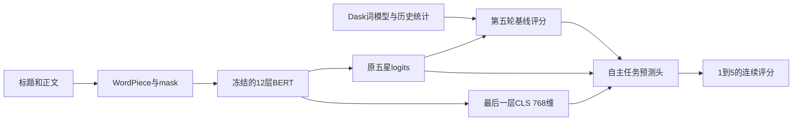

# BERT原理与本项目答辩指南

整理日期：2026-11-08。老师允许外部预训练模型的条件是自己理解模型；本指南帮助理解，
不能代替团队成员亲自读代码、解释实验和确认课程要求。

## 1. 先准确说清楚我们用了什么

本项目使用NLP Town发布的 `bert-base-multilingual-uncased-sentiment`，
固定采用Xenova仓库的ONNX量化导出。它是在产品评论五星任务上进一步训练的多语言BERT。
作者模型卡说明覆盖六种语言，英文部分15万条评论；本项目未查找或下载这些原始评分。
来源：[原作者模型卡](https://huggingface.co/nlptown/bert-base-multilingual-uncased-sentiment)。

本地config.json给出的实际结构是12层、隐藏维768、12个注意力头、前馈维3072、词表105879。
不要直接把英文BERT-base常见的词表大小和参数量套到这个多语言模型上。
模型版本、网络文件和分词器指纹保存在实验记录里；“同名模型”不保证永远是相同权重。

第五轮使用原五星输出与其他特征融合，用户反馈线上RMSE=0.54604。
第六轮增加最后一层768维CLS表示，自主训练任务预测头；具体哪个头胜出以结果报告为准。
它是冻结编码器上的任务适配，没有更新BERT内部参数，不能写成全参数微调BERT。



## 2. 一条评论怎样变成输入

标题和正文作为一对文本，分词后形如：

```text
[CLS] title 的 WordPiece [SEP] comment 的 WordPiece [SEP] [PAD] ...
```

WordPiece把词拆成词表中的片段；它不是简单按空格得到每个完整单词。
token id用于查词向量；位置向量表示顺序，segment id区分标题和正文。
attention_mask的0表示补齐位置，不能被当成真实词参与注意力。
本项目上限128个token，超长文本会截断，因此尾部的转折或缺点可能丢失。

例如“not good”和“good”的词袋可能都很正面，上下文编码器可以让good的表示受到not影响。
它也可能误解讽刺、隐含表达或很长的混合情绪，不能把这个例子当作模型永不出错的保证。

## 3. Transformer编码器具体做了什么

一个头把当前表示H变成Q=HWq、K=HWk、V=HWv，按下面公式混合各位置的信息：

```text
Attention(Q,K,V) = softmax(Q K^T / sqrt(d_head) + mask) V
```

每个头的维度是768/12=64。12个头的输出拼接、线性变换后，再经过残差连接与归一化；
点积的方差随维度增加，除以sqrt(64)可控制尺度，减少softmax过早饱和。
前馈子层逐位置做768→3072→768的非线性变换。12个编码块依次更新表示。
这部分基础结构来自[Transformer原论文](https://arxiv.org/abs/1706.03762)。

BERT使用双向上下文编码。其经典预训练包括遮盖词预测和句间关系学习，学习语言表示，
随后可接任务头适配分类等任务。它与只预测下一个词的自回归语言模型训练方式不同。
来源：[BERT原论文](https://arxiv.org/abs/1810.04805)。

这里的注意力权重只是网络内部计算量，不能直接当作某个词对评分的因果解释。
我们保留词袋、用户和商品统计，是因为语言之外还有历史偏好等信息。

## 4. CLS、pooler和五星输出有什么区别

最后一层输出的形状是batch×length×768。取位置0得到batch×768的CLS表示。
它经过上下文网络更新，不是把全部token简单求平均。
原BERT分类器随后做Dense+Tanh的pooler，再映射成五个logits。
官方接口也明确区分last_hidden_state与pooler_output，见[Hugging Face BERT文档](https://huggingface.co/docs/transformers/model_doc/bert)。

第六轮取的是pooler之前的CLS。原图节点是 `/bert/pooler/Gather_output_0`，
`embedding_prepare.py`只增加Identity输出，不改权重；相同256条输入的五星logits与原图逐值一致。

五星logits再经过softmax得到q1至q5，预测评分可以取sum(k*qk)。
例如模型不确定是4星还是5星时，输出4.6是合理的RMSE预测，直接argmax会丢失这种不确定性。
768维比五个数保留更多信息，但也增加过拟合风险；是否改善必须看同条件的冻结确认和去CLS消融。

## 5. 为什么要处理评分噪声

前期训练审计发现精确星级标题对应的观测标签分布接近25%的均匀替换。
这支持一个可检验的噪声假设，不证明所有评论都完全遵守它。

设潜在干净分布为q，噪声率epsilon，则观测分布r=(1-epsilon)*q+epsilon/5。
如果真实评分必为5且epsilon=0.25，观测到5的概率是0.8，其他评分各0.05，平均观测评分为4.5。
所以直接学观测平均值会向3收缩。我们仍记录原观测RMSE，并明确本地潜在风险是模型假设下的估计。

自主噪声通道头最小化观测标签的负对数似然-log(r_y)，最终预测潜在分布q的评分期望。
它对logits的梯度是w*(q-one_hot(y))，其中w=(1-epsilon)*q_y/r_y。
在该模型下w表示观测来自干净通道的后验权重；它不是已知的真实标签正确性。
对应实现见 `noise_softmax.py` 和 `embedding_heads.py`，梯度经独立有限差分验证。
线性头使用SciPy的L-BFGS通用数值优化器求参数，项目实现损失和解析梯度；这与调用现成分类器不同。

残差岭回归采用另一个目标：未裁剪逆通道评分(y-3*epsilon)/(1-epsilon)，拟合相对旧预测的残差。
它可能超出1–5，这是噪声校正目标的性质；最后的输出才裁剪，不能在训练前截断该目标。

## 6. 自主MLP头怎样训练

先固定一个线性噪声通道作为锚点，再学习：

```text
h = tanh(z W1 + b1)
new_logits = anchor_logits + dropout(h) W2 + b2
```

z只用训练行统计的均值/方差标准化。隐藏维64；训练时dropout以0.2概率关闭隐藏单元，
保留部分除以0.8，推理时关闭dropout。反向传播依次经过五星损失、W2、tanh导数1-h²和W1。
代码自己实现梯度、L2正则、梯度裁剪与Adam一阶/二阶矩和偏差修正。
没有调用现成MLPClassifier，也没有向冻结的BERT反向传播。

初始W2为0，所以初始网络等于线性锚点，之后再学习额外修正。
梯度测试固定dropout mask，用中心差分检查整条链；训练隔离测试修改验证标签不改变训练参数。
即使数学实现正确，MLP也可能比岭回归或线性头差，最终必须报告选型结果。

## 7. 验证、量化与大数据框架边界

83,047条有用户/商品/父商品历史的验证记录匹配测试身份支持条件。
内部训练33,437条、检查8,268条、冻结确认41,342条；确认不用于再调参数。
这些分组已被历史方案复用，所以不能称为从未见过的完全独立测试。
预训练语料与竞赛评论是否重叠未知，也应保留这一限制。

冻结网络做CPU动态量化推理，内部部分运算是int8，输出CLS是float32；float32输出不代表内部没有量化。
动态量化的激活范围可能随批组成变化，因此固定批量16、长度排序和128上限。
本轮同一批logits同时供旧基线与新头使用；测试集还会核对旧基线与0.54604对应CSV的一致性。

原词模型与历史统计由Dask实际处理768万训练评论，本轮继续使用其参数。
新增CLS推理和头训练为本地阶段，不能声称是分布式BERT全量训练。
报告里分别列继承阶段与新增阶段的耗时，不能只报小头训练时间却说是项目总训练时间。

## 8. 建议能独立回答的答辩问题

1. 模型作者、固定版本、层数、隐藏维、注意力头数是什么？从本地哪份配置核对？
2. WordPiece、segment id、attention_mask分别解决什么问题？截断有什么代价？
3. Q/K/V怎样形成注意力？为什么每个头除以sqrt(64)？
4. CLS与pooler输出、五星logits有什么区别？第六轮从哪里取特征？
5. 哪些参数冻结、哪些是项目自己训练的？能否把本轮写成全参数微调？
6. 为什么观测评分会向3收缩？噪声通道的梯度责任权重表示什么？
7. 如何证明归一化和训练没读取确认标签？为什么合成实验不能证明真实数据假设成立？
8. Dask实际在哪个阶段使用？哪部分耗时最大？去CLS消融和线上反馈分别说明什么？

请结合本轮结果报告中的真实胜出模型和失败对照回答，而不是把所有已实现路线都说成最终模型。
